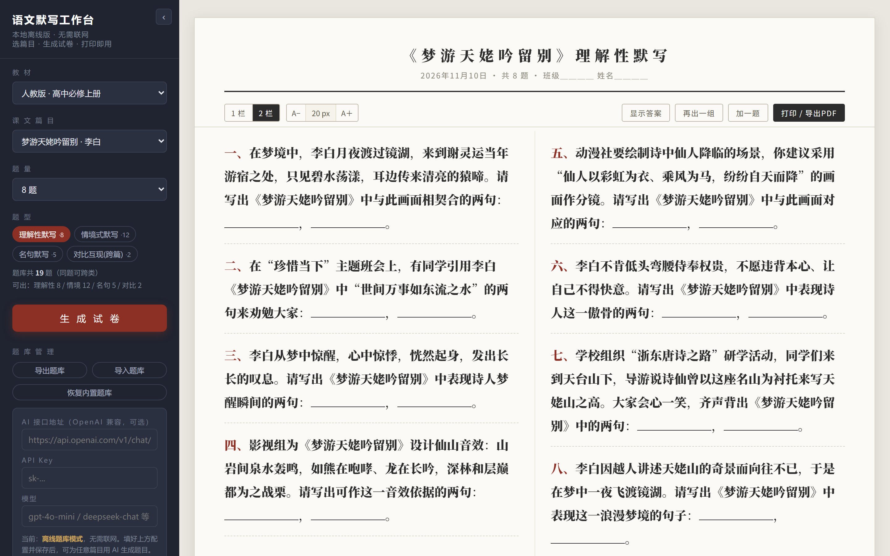
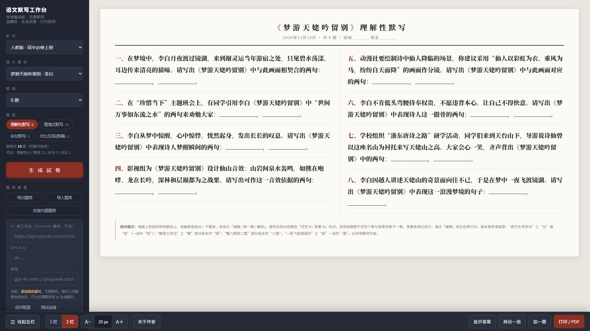
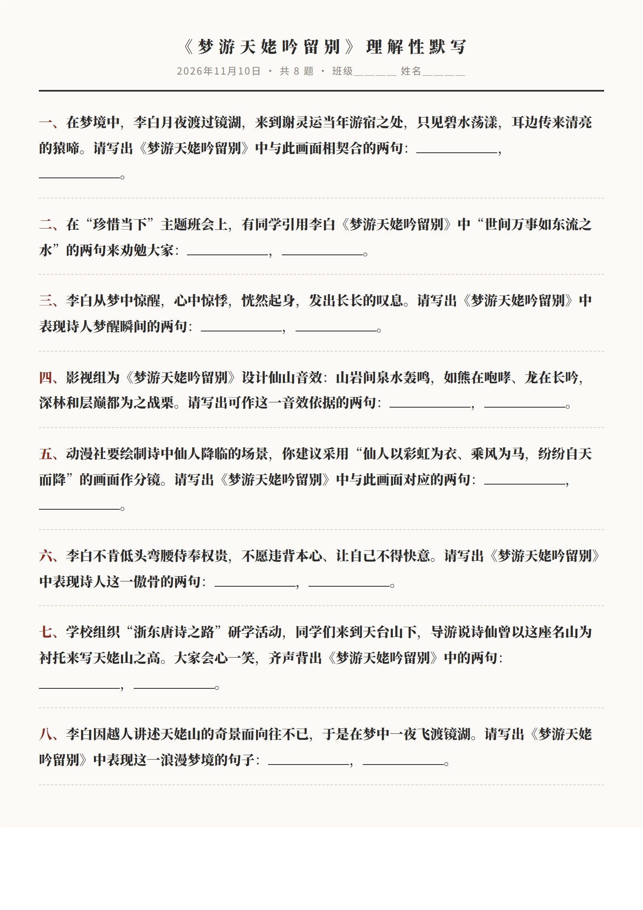

# 语文默写工作台

高中语文默写试卷生成器。**单文件、纯前端、零依赖**——双击 HTML 即可使用，无需安装、无需服务器，默认完全离线。

内置人教版高中语文（必修上下 / 选择性必修上中下）及初中九年级共 **51 篇课文、543 道默写题**，已逐题人工校对，覆盖理解性默写、情境式默写、名句默写、对比互现（跨篇）四类题型。



## 两个版本

| 文件 | 适用场景 | 交互方式 |
| --- | --- | --- |
| `语文默写工作台-本地版.html` | 电脑桌面（鼠标 / 键盘） | 顶部工具栏 + 可收起左侧栏，支持快捷键 |
| `语文默写工作台-触屏版.html` | 希沃等教室触屏白板（无鼠标） | 底部触屏工具条，≥44px 触控目标，适配安全区 |

两个版本共享同一套题库与功能，仅界面布局不同，按设备任选其一即可。



## 功能

- **选篇组卷**：按教材 → 篇目选择，设置题型（可多选）与题量（5 / 8 / 10 题），一键生成试卷；支持「再出一组」「加一题」。
- **逐题校对**：悬停题目可编辑、换一题、删除；挖空数与答案数不一致时自动标黄提醒，避免答案错位。
- **答案防泄露**：答案隐藏时不写入 DOM，无法通过选中 / 复制获取；打印时强制隐藏答案。
- **打印 / 导出 PDF**：打印件固定单栏与字号，不受投屏设置影响，带「班级 / 姓名」填写栏，打印即用。
- **投屏友好**（本地版快捷键）：`1` / `2` 切换分栏，`[` / `]` 调整字号，`A` 显示 / 隐藏答案，`S` 收起 / 展开左栏。
- **题库管理**：JSON 导出 / 导入自定义题库，一键恢复内置题库；支持自定义篇目。
- **AI 出题（可选）**：配置任意 OpenAI 兼容接口（API 地址 + Key + 模型）后可用 AI 扩充题目，内置出题规范提示词；不配置则全程使用离线题库。

## 使用方法

1. 下载（或克隆）本仓库，双击打开对应版本的 HTML 文件。
2. 在左侧选择教材、篇目、题型、题量，点击「生成试卷」。
3. 检查无误后点击「打印 / 导出 PDF」。



如需 AI 出题：在左栏「AI 接口地址」填写 OpenAI 兼容的 chat/completions 端点、API Key 与模型名，点「保存配置」「测试连接」即可。

### 题库格式

导入 / 导出均为 JSON，题目结构如下：

```json
{
  "劝学 · 荀子": [
    {
      "q": "同学练字三天就想放弃，你想用《劝学》中关于坚持的句子鼓励他：{1}，{2}。",
      "a": ["锲而不舍", "金石可镂"],
      "t": ["理解性默写"]
    }
  ]
}
```

- `q`：题干，挖空位置用 `{1} {2} {3}` 标注，个数必须与答案条数一致；
- `a`：答案数组，每空一句，忠于原文；
- `t`：题型标签（可选，缺省为「理解性默写」）。

## 隐私说明

- 默认不发起任何网络请求，无外部脚本、无 CDN、无追踪。
- AI 配置（含 API Key）仅保存在本机浏览器 localStorage 中，只发往你自己填写的接口地址。请勿在公共电脑上保存 Key。

## 技术说明

- 单个 HTML 文件内联全部 CSS / JavaScript，无构建步骤、无第三方依赖；
- 题库以其自然篇目归属为准，适用于中国大陆人教版教材体系，欢迎补充其他版本教材的题库。

## 设计复盘

每个功能背后，都是教室里一个具体的难处：网络不稳、后排看不清、希沃只有触屏、老师要马上能用。

## 开源协议

[MIT](LICENSE) © 2026 Vavov5

可自由使用、修改、分发，包括商用。题目内容供教学参考，正式使用前请自行核对答案与教学要求。

## 给作者一杯咖啡

如果这个工作台为你的备课省了时间，欢迎扫码请作者喝杯咖啡（微信支付）：


## 联系作者

- 邮箱：<xuweiwu1996@qq.com>
- 使用问题、题库纠错、功能建议：欢迎提 [Issue](https://github.com/Vavov5/chinese-dictation-workbench/issues) 或邮件联系